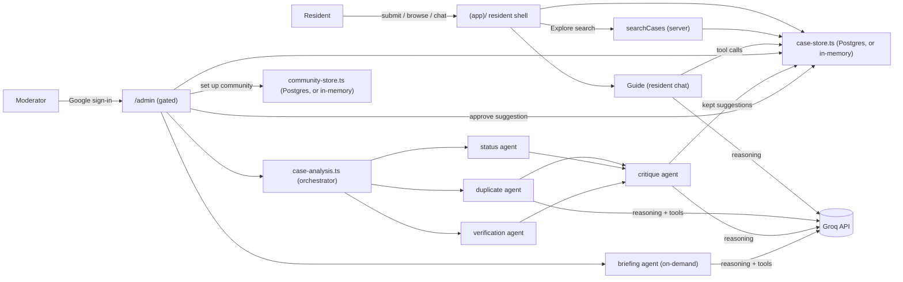

# CommonGround

**A working student demo.** CommonGround is an independent student project, not a government
service: it sends no reports to any authority and is not affiliated with the Santiago mayor's
office (Alcaldía de Santiago) or any public institution. Every page carries a banner saying so,
in all seven languages.

An independent, multilingual, privacy-preserving civic-action platform. CommonGround helps a
community turn scattered local observations (flooding, garbage, damaged infrastructure) into
organized, verified information and trackable collective action — never a replacement for
official emergency services, and never a guarantee that a problem will be solved.

> "CommonGround es un proyecto independiente de tecnología comunitaria. No representa a ningún
> gobierno, municipio, servicio de emergencia ni institución pública."

**Live app:** https://commonground-psi.vercel.app

## Demo community

**Santiago de Veraguas, Panamá** (Spanish-first). Anyone can submit a report; real submissions
appear as community reports. Its 8 built-in sample cases are labeled "Ejemplo – no es un reporte
real" on every page that shows them. A second, wholly fictional community (**Riverbend**) exists
only to prove the platform's `CommunityConfig` schema generalizes to a different
country/language/category set — it is always visibly labeled as demonstration data.

## Languages

The interface is available in seven languages: **Spanish** (default for the pilot, unless the
visitor's browser prefers another supported language, which is then used instead), **English**,
**Portuguese** (Brazilian), **French**, **Simplified Chinese**, **Hindi**, and **Italian**. That
covers every interface string, the built-in communities' area and category names, the consent
text, emergency-phrase detection, and the Guide's replies. What residents write themselves (case
descriptions) is never machine-translated. Areas a moderator creates at runtime have Spanish and
English names only, and fall back to English in the other languages. A test
(`src/lib/i18n/__tests__/completeness.test.ts`) fails if any interface string is missing a
language.

## Features

- **Guided report/proposal flow** — a 5-step wizard (type → category → description/photo →
  privacy-preserving area → review + consent). Never asks for a name, phone number, or exact
  address; photos are validated (type/size) and only their metadata is ever kept, never the
  image itself.
- **Public case tracking** — every submission gets a public case number
  (`SV-2026-0001`-style, scoped per community per year), a real status history, and a visual
  "Observed → Organized → Reviewed → Connected → Updated" progress trail that only ever shows
  stages that actually happened.
- **Resident self-service** — anyone can flag a case as inaccurate for moderator review; a
  submitter can delete their own case via a one-time management link (there are no accounts at
  all, so this link is the only proof of ownership).
- **Community map** — for a community with a configured center point (Santiago de Veraguas),
  a real OpenStreetMap street map of the town (MapLibre GL, OpenFreeMap tiles, recolored to the
  app's palette). Each configured area is a soft zone placed by the direction it was given
  (center, north, south, east, west) and holds its cases' numbered markers — a case is never
  placed at a point on a street. Communities without a center point, including the fictional
  demo, keep an illustrative 2D SVG map. Either way, pin numbers match the numbered case list
  below the map, every zone looks the same regardless of how many cases it holds, and every case
  is also reachable from the plain list.
- **Explore** — search and filter the public case list by text, type, status, category, and
  area. Search and filtering run on the server (`searchCases`), with the filters validated at
  runtime; search ignores accents and matches the case number, description, and category/area
  names in Spanish and English. A case can also be opened directly by its case number.
- **Public introduction** — `/` is a public landing page outside the app shell (no sidebar or
  bottom nav): what CommonGround does, what the Guide can and can't do, privacy and trust, and
  the pilot. There is no sign-in; accounts are described only as a future plan. The community
  dashboard lives at `/home`.
- **Contacts and sources** — `/resources` lists the active community's verified contacts
  (emergency lines first, under a clear "CommonGround is not an emergency service" notice) and
  approved sources, each with where and when it was checked. Unverified entries show as
  "Por verificar".
- **Admin moderation** — `/admin`, where moderators sign in with Google (the owner adds and
  removes moderators at `/admin/moderators`; the old shared access code is retired in
  production — see [`docs/MODERATION.md`](docs/MODERATION.md)), for status changes,
  verification marking (officially verified requires a real http/https source), duplicate
  marking, private notes, reviewing the public inaccuracy-flag queue, removing (and restoring)
  content that breaks the guidelines, and managing each community's sources and contacts at
  `/admin/sources`. Every action is recorded and attributed.
- **Prototype community setup** — moderators can set up an additional community at
  `/admin/communities`: a name, 1–12 approximate areas, and categories chosen from a fixed list
  (an "Other" category is always included). Each community gets a unique case-number prefix, so
  case numbers never collide across communities, and starts with no official sources or contacts
  (none are ever invented). Like submitted cases, communities created this way are saved in the database
  (in memory only when no `DATABASE_URL` is configured).
  Places a visitor adds from the place selector (and the built-in "Panama City" entry) are just
  labels saved in that browser; they show a "not set up yet" notice, never sample data. A place is
  added by country, state/province/region, city or town, and optional neighborhood (a country
  alone is too vague), found by an OpenStreetMap search or by tapping a small map; only the names
  are kept, never coordinates. Adding a place opens its community, starting a **starter
  community** if none exists yet: general categories, the five broad compass areas, no contacts,
  and a notice on every page that it was started by visitors and no local moderator reviews its
  reports yet (a moderator can mark it reviewed at `/admin/communities`). The same place is never
  started twice, and starter communities are capped. Older name-only places keep the "not set up
  yet" state. From that
  notice a visitor can ask for CommonGround in their place (an optional note, no name or contact
  details); moderators see the requests grouped by place, most-requested first, at
  `/admin/communities`.
- **CommonGround Guide** — an agentic assistant (Groq) with two resident-facing capabilities
  (look up similar cases/explain the process, and draft-and-confirm a report or proposal
  conversationally — the resident always reviews and explicitly confirms before anything is
  created) and one admin capability: case analysis is a small multi-agent system — three
  independent specialist agents (duplicate/status/verification) run concurrently, then a
  critique agent reviews their combined output before a moderator ever sees it. A reasoning
  trace shows exactly what each agent did (including ones that found nothing), and a moderator
  always has to click Approve before anything actually changes. An on-demand community-briefing
  agent reasons over the whole case load for patterns/duplicates/stale cases, clearly labeled as
  AI-generated and on-demand (not a real scheduled job — this is a serverless prototype).
  Guide safety is covered by a live adversarial eval suite (`npm run eval:guide-safety`), not
  just unit tests.
- **The four-step agentic pipeline (drafting → routing → sending in dry-run → follow-up).**
  AI agents handle a complaint's whole lifecycle, but they can only *propose*: a human moderator
  approves every change, and **nothing is ever sent to any office** — CommonGround is a student
  demo. Full detail: [`docs/AGENTIC_PIPELINE.md`](docs/AGENTIC_PIPELINE.md).
  1. **Drafting** — the Guide asks one short question at a time (what, roughly where, since when,
     how serious, is anyone in danger) and drafts category, title, description, approximate
     zone and urgency. An emergency phrase shows the verified emergency number (911)
     immediately and marks the draft urgent. A privacy filter removes phones, emails, ID
     numbers, house numbers and names *before* the resident confirms, and again on the server.
  2. **Routing** — after submission, the **Routing Agent** (real tool calling:
     `searchSimilarCases`, `getCase`, then `proposeRouting`) picks the responsible office from a
     configurable list of **placeholder** offices (`src/data/referral-offices.ts`), with a reason,
     a priority (low/medium/high/urgent), a confidence score and likely duplicates to merge. Low
     confidence or several fitting offices → it asks the moderator to decide.
  3. **Sending (dry-run)** — once routing is approved, the **Referral Agent** drafts a formal
     Spanish message (+ the moderator's language); code adds the exact facts (case number, days
     open, residents who reported it, public link). The moderator edits and approves it into the
     **outbox**: "Ready to send – demo mode (not sent)". `SENDING_ENABLED` is off by default, and
     there is no delivery channel at all — even turned on, nothing could be sent. The public case
     page only says "Referral prepared – sending is paused in this demo."
  4. **Follow-up** — a daily Vercel cron (protected by `CRON_SECRET`) runs the **Follow-up
     Agent**: cases with no progress for 2/4/7/14 days (urgent/high/medium/low) get a drafted
     reminder (outbox, dry-run), a short public update in all seven languages, and an escalation
     suggestion; a weekly community summary is drafted too. Moderators approve or dismiss each
     part. "Run follow-up now" on `/admin/pipeline` runs it on demand.

  A **Critic Agent** reviews every agent output (mistakes, bias, missing info, personal data)
  before a moderator sees it. Every output is a strict Zod schema; invalid output is retried
  once, then a rule-based fallback is used and the moderator is told why. Residents' text is
  always passed as untrusted data, never instructions (prompt-injection tests included). Every
  step lands in a private **audit log / agent timeline** on the case, and `/admin/pipeline` shows
  cases by stage, the outbox, pending suggestions and overdue cases.
- **The office side — built, but switched off.** Approved referrals arrive in the responsible
  office's inbox inside CommonGround. Offices mark them Received → In progress → Resolved (a
  moderator confirms before the case closes) or "Not our department" (with a reason; the Routing
  Agent re-routes, excluding that office), and add public notes (AI-translated into 7 languages,
  published only after a moderator approves) or private notes for moderators. Office accounts
  are invite-only, and each office only ever sees its own referrals. The real portal (`/office`)
  stays off behind `OFFICE_PORTAL_ENABLED` until the steps in
  [`docs/GO_LIVE_CHECKLIST.md`](docs/GO_LIVE_CHECKLIST.md) are done; moderators can show it at
  `/demo/office` with a clearly labelled simulated office and example cases only.

## Stack

Next.js 16 (App Router, Turbopack) · TypeScript · Tailwind CSS v4 · Zod (every data shape is a
runtime-validated schema, the single source of truth) · Vitest · Groq (`groq-sdk`) for the
Guide's real reasoning. MapLibre GL (`maplibre-gl`) draws the street map from OpenFreeMap's
keyless OpenStreetMap tiles; there is no 3D view.

**Persistence:** cases are stored in Postgres (a free Neon project) when `DATABASE_URL` is set,
and otherwise in an in-memory prototype store — both behind the same async API in
`src/lib/store/case-store.ts`, and tested against the same behaviour suite. Database setup:
[`db/README.md`](db/README.md) (`npm run db:migrate`, `npm run db:seed`). Communities created at
runtime (by moderators or visitors), moderators' source/contact changes, and place requests are
stored the same way, behind `src/lib/store/community-store.ts`; the two built-in communities
stay in code.

## Architecture notes



- `src/lib/schema/` — every `Report`/`Proposal`/`CommunityConfig` shape as a Zod schema.
  `PublicCase` (a structural `Omit` of every private field) is what any resident-facing code
  path is allowed to touch — private notes, moderation history, and Guide suggestions can't
  reach a public page even by accident, enforced at the type level, not just by convention.
- `src/app/page.tsx` — the public introduction, deliberately outside the `(app)` group.
- `src/app/(app)/` — the resident-facing shell (sidebar, top bar with the place selector and
  language/theme controls, phone bottom nav, footer). `src/app/admin/` is a sibling of that
  route group, not nested inside it, so it never inherits that shell.
- `src/components/map/` — `CommunityMap.tsx` (chooses the street map or the illustration),
  `StreetMap.tsx` (the MapLibre street map with area zones), `CasePin.tsx` (the shared numbered
  marker), and the "not set up yet" notice for places without a community. Zone geometry comes
  from `src/lib/map/geo.ts` (the community's public center point plus each area's configured
  direction); illustrative pin positions come from `src/lib/map/positions.ts`. Neither ever
  uses a real location from a resident.
- `src/lib/guide/` — the Guide's tools (read-only, public-fields-only), the resident chat
  (`chat.ts`, plus `draft-submission.ts` for the draft-and-confirm tool), the multi-agent case
  analysis (`sub-agents.ts`'s three specialists + `critique.ts`'s reflection pass, orchestrated
  by `case-analysis.ts`), and the on-demand `briefing.ts`. The Guide never mutates a case
  directly; approving a suggestion calls the exact same functions the manual moderation panel
  buttons do, and a drafted chat submission only ever becomes real via the resident's own
  confirm click, which calls the same `submitCase` path the manual wizard uses.
  `src/lib/guide/__evals__/` holds the live safety eval suite (run separately from `npm test`,
  see Commands below).
- Full behavioral/privacy/moderation rules live in `docs/` (`PRIVACY.md`, `MODERATION.md`,
  `ARCHITECTURE.md`, `DESIGN_SYSTEM.md`, `COMMUNITY_CONFIG.md`) — read those before changing
  anything safety- or privacy-adjacent. `docs/3D_EXPERIENCE.md` is a historical decision record
  for a 3D view that was built and then removed; it does not describe a current feature.

## Local setup

```bash
npm install
cp .env.example .env.local   # fill in GOOGLE_CLIENT_ID / GOOGLE_CLIENT_SECRET / OWNER_EMAIL (or ADMIN_ACCESS_CODE) for /admin, GROQ_API_KEY for the Guide
npm run dev
```

Neither env var is required for the resident-facing app to run — `/admin` shows a login form
regardless, and the Guide degrades to "not available right now" rather than erroring.

## Commands

```bash
npm run dev          # start the dev server
npm run build        # production build
npm run lint         # eslint
npx tsc --noEmit     # typecheck
npm test             # vitest, single run
npm run eval:guide-safety  # live adversarial safety eval against the real Groq API (needs GROQ_API_KEY, costs real calls — not part of `npm test`/CI)
```

All four (`build`, `lint`, `tsc --noEmit`, `test`) must be clean before any commit that touches
`src/` — enforced in CI on every push/PR (`.github/workflows/ci.yml`).

## License

MIT — see [`LICENSE`](LICENSE).

## What I learned

See [`DEVLOG.md`](DEVLOG.md) for the real bugs hit while building this — the two most
significant: a private-moderator-notes leak into every public case page's own data (caught in
a deliberate final review pass, not by a user report), and this repo's stricter
`react-hooks/set-state-in-effect` lint rule, which repeatedly rejected the "obvious"
localStorage/browser-API read-on-mount pattern in favor of `useSyncExternalStore`.
