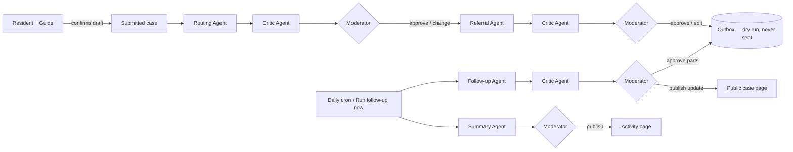

# The agentic pipeline

CommonGround's AI agents handle the whole lifecycle of a complaint — drafting, routing, sending,
follow-up — but only ever **propose**. A human moderator approves every action that changes a
case or publishes anything, and **nothing is ever sent outside CommonGround**: it is a student
demo with no agreement with any office.



The stages shown to moderators: **Drafted → Routed → Reviewed by agents → Referral prepared
(sending paused) → Follow-up** (`stageOf` in `src/lib/pipeline/pipeline.ts`).

## Hard safety rules, and where each is enforced

| Rule | Enforced by |
|---|---|
| Nothing is ever sent | `src/lib/pipeline/sending.ts`: `SENDING_ENABLED` must be exactly `"true"`, defaults off, and even then there is **no delivery channel** — `deliverOutboxItem` refuses. The database only allows outbox status `dry_run` (`pipeline_outbox_status_check`). `safety.test.ts` blocks `fetch`, `http`, `https` and `net` and proves no call happens with the flag unset, `false`, or `true`. |
| A moderator approves every change | Agents write only to `pipeline_proposals` and `agent_audit`. Every case change happens in the `approve…` functions in `pipeline.ts`, called only from moderator-only server actions (`src/lib/pipeline/actions.ts`, `requireAdmin()` + runtime validation). Approval uses the same store functions as the manual buttons (`addTimelineEvent`, `markDuplicate`, `setRouting`). |
| Residents' text is data, not instructions | `src/lib/pipeline/untrusted.ts` wraps it in markers the text can't close, every agent prompt carries the security rule, outputs are Zod-validated against the real config (an office that doesn't exist is rejected), and instruction-like text is flagged so the moderator must decide. Tested in `safety.test.ts`. |
| No invented contacts | `src/data/referral-offices.ts`: every office is a generic, labelled "example office" with a `.invalid` email (can never deliver) and an all-zero phone. The real verified contacts stay on the Contacts page and are never referral targets. |
| Anonymity | `src/lib/pipeline/redact.ts` removes emails, phones, Panamanian ID numbers, house/apartment numbers and "my name is …" (7 languages) — in the Guide's draft and the form's review step (so residents see it), on the server before saving, before any agent prompt, and in the Critic's checks of every outgoing text. |
| Seven languages | Resident-facing text (`FIELD.pipeline`, timeline kinds, follow-up updates, weekly highlights) exists in all seven; `completeness.test.ts` enforces it. |

## The agents

All agents use real tool calling through `runToolAgent` (`src/lib/pipeline/agent-runner.ts`):
read-only lookup tools, then exactly one "propose" tool whose arguments are parsed by a strict Zod
schema plus a `validate` check against the real world. Invalid output is sent back once with the
error; a second failure returns `invalid_output`, and the caller falls back to rules and tells the
moderator why (`failureNote`). Groq rate limits and server errors are retried with backoff by the
SDK (`maxRetries` in `groq-client.ts`); what still fails becomes a clear message, never a crash.

| Agent | Tools | Output |
|---|---|---|
| Guide (`src/lib/guide/chat.ts`) | `search_similar_cases`, `get_case_details`, `draft_case_submission` | category, title, description, area, urgency — the resident confirms |
| Routing Agent | `searchSimilarCases`, `getCase`, `proposeRouting` | office, reason, priority + reason, confidence, alternatives, duplicates |
| Referral Agent | `getCase`, `draftReferral` | Spanish message (+ moderator's language); code adds the facts block |
| Critic Agent | `recordCritique` | ok / concerns with typed issues (mistake, bias, missing_info, personal_data, other) |
| Follow-up Agent | `proposeStatusUpdate` | reminder (Spanish), public update (7 languages), escalation |
| Summary Agent | `recordHighlight` | 1–2 sentence highlight (7 languages); the numbers are counted by code |

Code, not the model, decides: when a moderator must choose (confidence < 0.6 or several offices
fit, `routing-rules.ts`), that an emergency stays urgent, which duplicates are real, which cases
are overdue (`schedule.ts`: urgent 2, high 4, medium 7, low 14 days), and every fact in an
outgoing message.

## Configuration

- Offices: `src/data/referral-offices.ts`.
- Follow-up limits: `FOLLOW_UP_AFTER_DAYS` in `src/lib/pipeline/schedule.ts`.
- Environment: `CRON_SECRET` (protects `/api/cron/follow-up`; Vercel sends it), `SENDING_ENABLED`
  (leave unset/`false`), `GROQ_API_KEY` (without it, every agent uses its rule-based fallback).
- Schedule: `vercel.json` runs the cron daily at 13:00 UTC (8:00 in Panama).

## Data

Migration `db/migrations/0007_agentic_pipeline.sql` adds `pipeline_case_state`,
`pipeline_proposals`, `pipeline_outbox` and `agent_audit` (Row Level Security on, no policies,
like every table) and two public timeline kinds, `referral_queued` and `follow_up_update`. Both
the migration's data part and `db/seed.sql` are generated from
`src/lib/pipeline/store/demo-pipeline-data.ts`, which walks the eight example cases through every
stage (labelled "Example data (written by hand)"). Resident cases are never given example data.

### Reset demo

`/admin/pipeline` → **Reset demo** puts the eight example cases back to their starting state
(timeline, status, suggestions, pipeline stage, outbox, audit log) in one transaction. It selects
only cases that are demonstration data in the demo community **and** carry one of the eight fixed
example descriptions; every delete is limited to those cases. `demo-reset.test.ts` proves, on
memory and on Postgres, that a resident case — even one copying an example description, with its
own pipeline records — is left exactly as it was. Community-wide weekly summaries are not reset.

### Backup and restore

Before 0007 was applied to production (2026-10-12), a full backup was taken and a restore was
rehearsed:

```bash
node --env-file=.env.local scripts/db-backup.mjs backup          # → ../commonground-backups/backup-<time>/
node --env-file=.env.local scripts/db-backup.mjs verify <folder>  # loads it into a temporary schema, checks counts, drops it
```

To go back to before the pipeline if something goes wrong:

1. Redeploy the last commit before the pipeline (`4cd357c`) in Vercel (Deployments → … →
   Promote/Redeploy), so the app stops using the new tables.
2. `node --env-file=.env.local scripts/db-backup.mjs rollback-0007` — drops the four tables and the
   two timeline kinds (`db/rollback/0007_agentic_pipeline_down.sql`, one transaction).
3. Only if data itself must be rewound: `node --env-file=.env.local scripts/db-backup.mjs restore <folder>`
   — replaces every table's rows with the backup's, in one transaction (all or nothing).

Neon's own point-in-time restore (console → Branches → Restore) is a second safety net within the
plan's history window.

## Tests

`src/lib/pipeline/__tests__/`: `pipeline.test.ts` (the full flow, schemas, merges, emergencies,
weekly summary, AI failures and rate limits), `safety.test.ts` (nothing sent; prompt injection;
Critic rules), `rules.test.ts` (routing rules, follow-up schedule, sending flag),
`redact.test.ts`, `agent-runner.test.ts`, `pipeline-repository-contract.test.ts` (memory and
Postgres stores behave the same). Plus `src/app/api/cron/follow-up/__tests__/route.test.ts` and
the Guide's draft/emergency tests. The AI is mocked in tests (`fake-groq.ts`), so they never
touch the network.

## Known limits

- Tests prove that injection attempts and invalid outputs are *contained*; they can't prove the
  model "understood" anything. Safety comes from the structure (propose-only, validation,
  moderator approval, no delivery channel).
- The privacy filter is rule-based: it catches common shapes but can miss an unusual name or
  address. Moderators read every case.
- The moderator screens are in English (the admin area always has been); everything residents
  see is in all seven languages.
- One cron run handles at most 6 follow-ups and 3 catch-up routings (Groq free tier, 120 s
  function limit); the rest wait for the next run.
